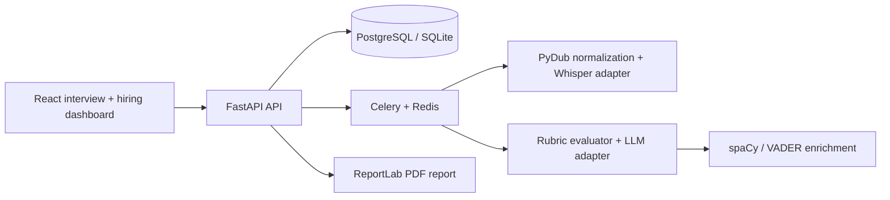

# HireIQ architecture

Audio is received as an upload, normalized and processed asynchronously in production. The demo path supplies a deterministic transcript when no audio/model provider is configured, making the complete UI testable without credentials. All model calls belong behind the API boundary.
